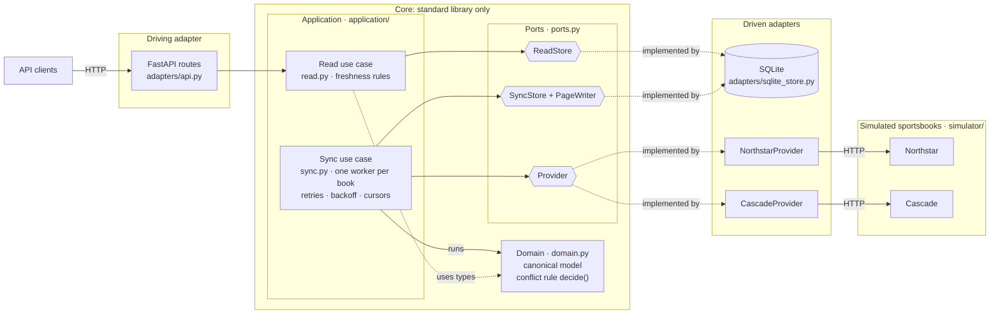
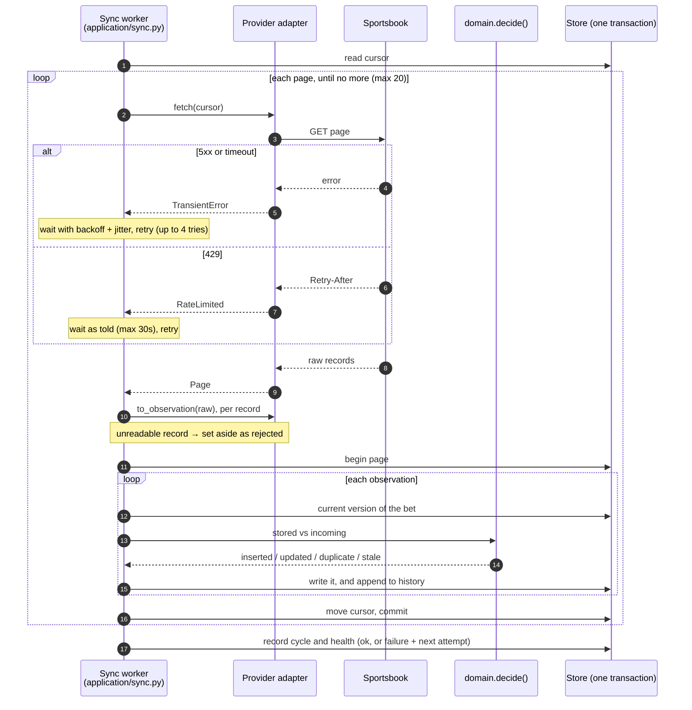

# Bet sync engine

A bettor has accounts at two sportsbooks. Each book reports their bets in its own format, through its own kind of API, and each misbehaves in its own way. This service keeps one dependable, canonical view of every bet, and is upfront about how fresh that view is.

Both sportsbooks are simulated inside the repo, so there are no credentials, accounts or network services to set up.

## Run it

Python 3.11 or newer.

```bash
python3 -m venv .venv && source .venv/bin/activate
pip install -r requirements.txt
python -m betsync --fresh
```

This starts one process with three parts: the two simulated sportsbooks, a sync worker per book, and the API on <http://127.0.0.1:8000>. Interactive API docs are at <http://127.0.0.1:8000/docs>. Simulated time runs 60× faster than real time (`--speed`), so games finish and bets settle within a few minutes. The default fault scenario is `realistic`; use `--scenario calm` for well-behaved books or `--scenario chaos` for heavy weather. `python -m betsync --help` lists every setting.

Tests: `python -m unittest` (about 50 tests, a few seconds). Lint: `pip install -r requirements-dev.txt && ruff check .`

Every change follows the hard rules in [METHODOLOGY.md](METHODOLOGY.md): hexagonal layers, docstrings on everything, and the lint rules in `pyproject.toml`. CI enforces all three.

### Try it

```bash
curl -s localhost:8000/status | python -m json.tool               # is sync healthy, degraded or stale?
curl -s 'localhost:8000/bets?status=won' | python -m json.tool     # canonical bets, with freshness
curl -s 'localhost:8000/bets?sportsbook=cascade&limit=5' | python -m json.tool
curl -s localhost:8000/bets/cascade:77003 | python -m json.tool    # one bet and every observation behind it
curl -s localhost:8000/events | python -m json.tool               # games, with each book's own ID for them

# Take Cascade down and watch its freshness degrade while Northstar carries on:
curl -s -X POST localhost:8000/upstream/cascade/_control -H 'content-type: application/json' -d '{"outage": true}'
sleep 40; curl -s localhost:8000/status | python -m json.tool      # cascade: "stale", overall: "stale"
curl -s 'localhost:8000/bets?sportsbook=cascade&limit=1' | python -m json.tool   # still served, marked stale
curl -s -X POST localhost:8000/upstream/cascade/_control -H 'content-type: application/json' -d '{"outage": false}'
curl -s -X POST 'localhost:8000/sync?provider=cascade'            # don't wait for the backoff
```

The `_control` endpoint accepts any fault setting, for example `{"error_rate": 0.5}`, `{"timeout_rate": 1}` or `{"rate_limit_per_sec": 1}`.

## The two sportsbooks

| | Northstar | Cascade |
|---|---|---|
| API style | current state of each bet, paged by `lastModified` | ordered change feed by sequence number, plus a single-ticket lookup |
| Bet ID | `"NS-10007"` | `77012` |
| Odds | American, as a string: `"+150"` | decimal: `2.5` |
| Money | dollar strings: `"25.00"` | integer cents: `2500` |
| Timestamps | ISO 8601 | epoch seconds |
| Status | `PENDING`, `SETTLED_WIN`, `VOIDED`, ... | `O`, `W`, `L`, `P`, `V`, `C` |
| Teams | codes: `PHX @ LAL` | full names, home/away sides |
| Its trouble | duplicates across pages; a lagging replica that serves older versions (out of order) | at-least-once redelivery; records missing optional fields |
| Both | random 5xx errors, timeouts, extra latency, rate limits (429 with `Retry-After`), outages on demand | |

The simulation is seeded (`--seed`). The same seed gives the same games, bets and failures every time. It lives in `betsync/simulator/`, kept separate from the service's own code.

## Design overview

The service is built as **ports and adapters** (hexagonal architecture). The business rules sit in the core and know nothing about HTTP, SQLite or any sportsbook's format. Everything that touches the outside world is an adapter that plugs into a port.



- **Domain** (`domain.py`) is where provider data becomes ours: the canonical bet, leg and event, and the conflict rule `decide()`.
- **Ports** (`ports.py`) say what the use cases need from the outside world: a `Provider` to fetch and translate a book's records, a `SyncStore` to write each page in one transaction, and a `ReadStore` to answer queries.
- **Application** (`application/`) holds the two use cases. **Sync** runs one worker per book: it fetches, translates, runs the conflict rule and stores, with its own retries, cursor and health. **Read** answers the API and attaches freshness to every answer.
- **Adapters** (`adapters/`) implement the ports: one per sportsbook, SQLite for storage, and FastAPI for the HTTP API.
- **The simulator** stands in for the real sportsbooks, so it sits outside the service entirely and is reached only over HTTP.
- **`__main__.py`** is the composition root: the only place that picks the adapters and wires them to the use cases.

Dependencies only point inwards, and the core uses nothing but the standard library. The test suite checks this on every change: see [METHODOLOGY.md](METHODOLOGY.md). In practice it means adding a third sportsbook is one new adapter file, and moving to Postgres is one new storage adapter. The use cases don't change in either case.

### One sync cycle

Each book's worker repeats this every few seconds, independently of the other book:



If a page fails after its retries run out, the pages before it stay committed and the next cycle resumes from the last saved cursor. After a successful cycle, the worker also re-fetches any bets still missing a field (see [Missing fields](#failure-duplicates-ordering-and-freshness)).

### Provider adapters (`betsync/adapters/providers/`, the `Provider` port in `betsync/ports.py`)

An adapter does two things: `fetch(cursor)` gets a page of raw records, and `to_observation(raw)` translates one record into the canonical model. It can optionally do a third, `fetch_record(id)`, which re-fetches one record to fill in missing fields. Retries, deduplication, conflict resolution, storage and health live in the sync use case, so neither adapter contains logic for the other book, and adding a third book means writing one file. Adapters raise one of four typed errors: `TransientError`, `RateLimited`, `PermanentError`, or `RecordError` for a single bad record.

### Canonical model and data ownership (`betsync/domain.py`)

This is where provider data becomes ours. Past this point, nothing knows a provider's field names, status codes or formats.

- **Bet:** ID `sportsbook:external_id`; status `open` / `won` / `lost` / `push` / `void` / `cashed_out`; stake and payout in integer cents; odds in American format; legs that point at canonical events.
- **Event:** the same real game is described differently by each book, as codes vs full names and with slightly different start times. Both resolve to one ID, like `nba-2026-11-01-phx-at-lal`, built from the league, the game's local date and the canonical team codes. Northstar's own event IDs are kept as aliases. Teams we don't recognise still get a stable ID, flagged `teams_recognised: false`.
- **Ownership:** each sportsbook owns its bets, and is the only source for them. The service owns the canonical identity (bet and event IDs), the merge decisions and freshness. Nothing is ever written back to a book.

### Lifecycle of a record

Following one Cascade ticket from start to finish (the values are an example):

1. The Cascade worker asks the change feed for changes after its saved cursor (`since_seq=212`) and gets ticket `77003` as `{"state": "W", "stake": 2500, "decimal_odds": 2.5, "return": 6250, "updated": 1793671800, ...}`.
2. `CascadeProvider.to_observation` translates it to a canonical `Bet`: `cascade:77003`, `won`, 2500 cents at `+150`, paying 6250, with its leg on `nba-2026-11-01-phx-at-lal`. The provider's timestamp comes along, plus any optional fields that were absent.
3. The sync use case runs the domain's `decide()` against what's stored. It's newer, so it's an **update**. A redelivered copy would be a **duplicate**, and an older version arriving late would be **stale**.
4. In one SQLite transaction: the bet row is updated (version 2), the observation is appended to its history with that outcome, and the cursor moves to 213. If the process dies first, the page is simply fetched again.
5. `GET /bets/cascade:77003` returns the canonical bet, Cascade's freshness (`ok`, last synced 3s ago), and the history: `inserted` (open), then `updated` (won).

### Storage (`betsync/adapters/sqlite_store.py`)

SQLite in WAL mode. The tables:
- **`bets`:** canonical state.
- **`events` and `event_aliases`:** canonical games, and each book's IDs for them.
- **`observations`:** every record received and what was done with it. This history is what makes a bet's current state explainable.
- **`rejected`:** records that couldn't be translated.
- **`provider_state`:** cursor and health per book.
- **`sync_runs`:** per-cycle counts.

## Failure, duplicates, ordering and freshness

**Retries.** A failed request is tried up to 4 times, with exponential backoff and full jitter between tries (a random wait of up to 0.5s, then 1s, then 2s, never more than 8s). A 429 waits for `Retry-After`, capped at 30s. A `PermanentError` (another 4xx, or a response we can't parse) isn't retried. Requests time out after 3s, so a hung book costs one timeout, not a stuck worker.

**Isolation.** Each book has its own worker thread, cursor and health. One book being slow or down never delays or changes the other.

**Partial success.** Each page is applied and the cursor advanced together, atomically. If page 3 fails, pages 1 and 2 are kept and the next cycle resumes at page 3. A record that can't be translated is set aside in `rejected`, and the rest of the page still syncs.

**Recovery.** After a failed cycle, the worker waits longer each time before the next one: the 5s poll interval doubles per consecutive failure, up to 60s. That stops a down book from being hammered. One success resets it.

**Duplicates.** Writes are idempotent. Content identical to what's stored is a no-op, apart from noting that the book confirmed it again. Duplicates come from three places:
- Cascade's at-least-once redelivery.
- Northstar repeating records across pages.
- Our own overlap re-read. After each Northstar sweep, the next starts two minutes before the newest change seen, because paging a list that changes underneath you can skip records that share a timestamp.

Replaying either feed from the start changes nothing; a test checks this.

**Ordering and conflicts.** The newest provider timestamp wins. An older version that arrives late, like Northstar's lagging replica serving a settled bet as still open, is recorded in the history as `stale` and never applied, so a settled bet can't be reopened. A different record at the *same* timestamp is treated as a correction and applied. Timestamps are only compared within one book, since each bet has exactly one source.

**Missing fields.** If an update leaves out an optional field (odds, payout or settlement time), the value we already hold is kept, and the bet notes which fields were carried over. If we never had the value, such as a ticket first seen already settled but without its payout, the bet is marked with `unknown_fields`. The worker then re-fetches that ticket on later cycles until the book sends the full record. Northstar has no single-record endpoint, so for Northstar the gap would stay visible rather than being guessed at.

**Freshness.** Each book has a status:
- **`ok`:** synced recently.
- **`degraded`:** recent attempts are failing, but our data is still inside the freshness window (30s by default).
- **`stale`:** no successful sync within the window.
- **`never_synced`:** no successful sync yet.

`/status` reports each book's status and the worst of them overall, along with last success, last error, consecutive failures, the next attempt and recent run counts. Every bet carries its own book's freshness, so a client can tell "this bet is open" from "this bet was open the last time we reached that book". Stale data is still served, because the best local answer beats no answer, but it's clearly marked.

Worker logs show one line per cycle, like `cascade: ok pages=1 received=12 inserted=0 updated=3 duplicate=9 stale=0 rejected=0 retries=1 repaired=0`.

## At much higher scale, I'd change first

1. **Work distribution.** Thousands of users with accounts at many books means one worker per (book, account), with a lease so only one process syncs it at a time. A queue or a Postgres `SKIP LOCKED` table would replace the in-process threads, and rate limits would be shared per book across workers.
2. **Storage.** Postgres instead of SQLite, with `(sportsbook, external_id)` as the idempotency key. The observations history would be partitioned by time with a retention window, or moved to cheap storage, since it grows with every poll.
3. **Push over poll.** Use webhooks or streams where books offer them, and keep polling as a reconciliation sweep that catches anything missed.
4. **Event identity.** Matching games by league, date and team names is fine for two books. At scale it needs a maintained mapping service, with manual review for anything unmatched.
5. **Observability.** Prometheus-style metrics and alerts (sync lag, error rate, stale books, rejected records) instead of a status endpoint you have to go and read.

## Layout

```
betsync/
  domain.py              canonical model, team/event identity, the conflict rule
  ports.py               the interfaces: Provider, SyncStore/PageWriter, ReadStore, and their errors
  application/
    sync.py              the sync use case: per-book workers, retries, backoff, cursors, repair
    read.py              the read use case: what the API returns, and the freshness rules
  adapters/
    providers/           one adapter per book, and the HTTP client
    sqlite_store.py      SQLite: canonical state, history, provider state
    api.py               FastAPI routes
  simulator/             the two simulated books, their seeded world and their faults
  __main__.py            the composition root: wires adapters to use cases
tests/                   domain, adapters, sync, real-HTTP end to end, API, methodology rules
METHODOLOGY.md           the hard rules for every change
pyproject.toml           lint rules (ruff)
```

## AI & Tools

**Tools.** I built this with Claude Code. It generated most of the code: the adapters, the sync engine, the simulator and its faults, the tests, the CI workflow and drafts of this README. GitHub Actions runs the checks on every push.

**What I decided.** The calls that shape the system were mine: the domain (sportsbook bet history), the stack (Python, FastAPI and SQLite), and the conflict rule (the newest provider timestamp wins). I also kept the providers simulated rather than pointing at real sportsbooks. The brief rules out credentials and hosted services, and only a simulator lets a reviewer trigger an outage on demand.

**Where I reworked the output.** The first version Claude Code produced worked, and its tests passed, but it was only partly hexagonal. The read service imported the SQLite store directly, and the conflict rule ran inside the storage code, so the database layer was making business decisions. I had it restructured into explicit layers: domain, ports, application and adapters. The use case now runs `decide()`, and storage only writes what it's told. The first version also had docstrings on only a handful of functions, so I made them a requirement everywhere.

**How I keep it that way.** Fixing the code once wasn't enough. Without rules, the next generated change could drift right back. So I wrote [METHODOLOGY.md](METHODOLOGY.md): hard rules for every change, whoever or whatever writes it. Each rule is enforced automatically, so it can't be skipped:

| Rule | Enforced by |
|---|---|
| Hexagonal layers: dependencies point inwards, adapters don't import each other, only the application runs the conflict rule | `tests/test_methodology.py` |
| A docstring on every module, class and function, private and nested ones included | `tests/test_methodology.py` and ruff |
| Lint rules | ruff, configured in `pyproject.toml` |
| Tests pass, and new behaviour comes with a test | CI |

To check the enforcement itself, I planted deliberate violations (an inner layer importing an adapter, a third-party import in the domain, an adapter importing another adapter, storage calling `decide()`, a missing docstring) and confirmed the tests caught every one. Every new change, mine or AI-generated, has to meet the definition of done in METHODOLOGY.md before it's merged. AI writes code faster than I could alone, while the rules, the tests and my review decide what's accepted.
